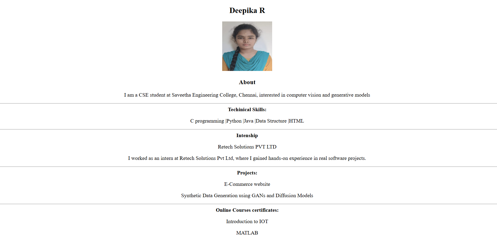

# Ex01 Portfolio
## Date:

## AIM
To create a Portfolio using HTML and CSS.

## ALGORITHM
### STEP 1
Create an HTML file (index.html)

### STEP 2
Create a CSS file (style.css)

### STEP 3
Include a navigation bar with links to different sections.

### STEP 4
Add structured sections for introduction, about, projects, and contact details.

### STEP 5
Define global styles for fonts, colors, and layout.

### STEP 6
Style the header, navigation bar, and sections.

### STEP 7
Use Flexbox or CSS Grid for layout design.

### STEP 8
Add hover effects and transitions for interactivity.

### STEP 9
Add Images and Media.

### STEP 10
Use optimized images for a professional look.

### STEP 11
Open the HTML file in a browser to check layout and functionality.

### STEP 12
Fix styling issues and refine content placement.

### STEP 13
Deploy the Portfolio.

### STEP 14
Upload to GitHub Pages for free hosting.

## PROGRAM
```
<!DOCTYPE html>
<html lang="en">
<head>
    <meta charset="UTF-8">
    <meta name="viewport" content="width=device-width, initial-scale=1.0">
    <title>Portfolio</title>
</head>
<center>
<body>
    <h2>Deepika R</h2>
    
    <h3>About</h3>
    <p>I am a CSE student at Saveetha Engineering College, Chennai, interested in computer vision and generative models</p>
    <hr>
    <b>Techinical Skills:</b>
     <p>C programming |Python |Java |Data Structure |HTML</p>
    <hr>
    <b> Intenship</b>
    <p>Retech Solutions PVT LTD </p>
    <p>I worked as an intern at Retech Solutions Pvt Ltd, where I gained hands-on experience in real software projects.</p>
    <hr>
    <b>Projects:</b>
    <p>E-Commerce website</p>
    <p>Synthetic Data Generation using GANs and Diffusion Models</p>

    <hr>
    <b>Online Courses certificates:</b>
    <p>Introduction to IOT</p>
    <p>MATLAB</p>
       
    
</body>
</center>

</html>
```

## OUTPUT


## RESULT
The program for creating Portfolio using HTML and CSS is executed successfully.
